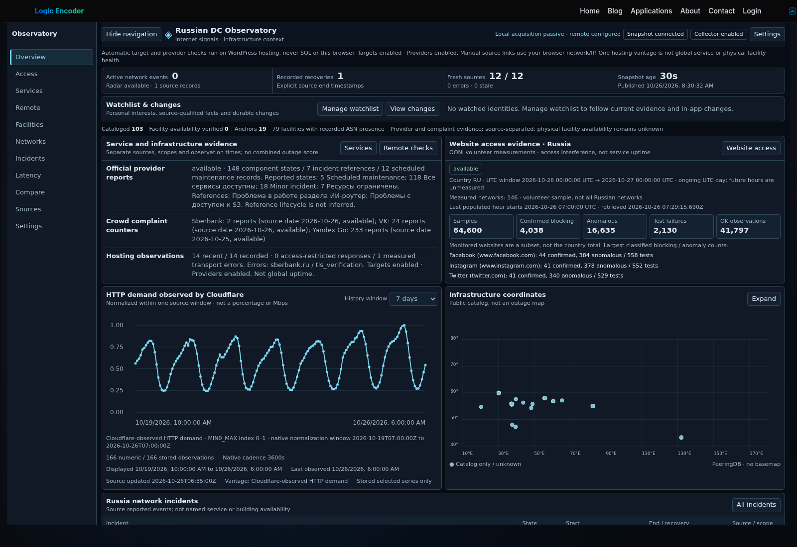

# Logic Encoder — Projects

A visual catalogue of applications, dashboards, operator tools and engineering projects built by Logic Encoder. Browse a short summary here, then open the product presentation for its capabilities, source context and additional views.

[Website](https://logicencoder.com) · [Web applications](https://logicencoder.com/applications/) · [Contact](https://logicencoder.com/contact/)

## Browse

- [Applications](#applications) — 8 projects
- [More applications](#more-applications) — 21 projects
- [Engineering notes](#engineering-notes) — 2 projects
- [Prototypes, skeletons and unfinished work](#prototypes-skeletons-and-unfinished-work) — 6 projects

Screenshots are historical views of the actual products, not promises of current readings. Product presentations describe limitations and availability. Fictional spacecraft experiences are explicitly identified as simulations.

## Applications

### Universal Service Manager

Review services, inspect logs and control the application fleet from one operator workspace.

[Overview](https://github.com/logicencoder/universal-service-manager-overview)

### MEXC Trading App

Bring market data, account context, manual orders and supported trading automation into one spot-trading workstation.

The same workstation exists for the Gate exchange.

[Overview](https://github.com/logicencoder/mexc_trading_app-overview)

### LE Karaoke Studio

Take media through transcription, karaoke/caption editing and rendering, with studio and repeatable automation workflows.

[Overview](https://github.com/logicencoder/le-karaoke-studio-overview)

### LE HSCR — Radio Monitoring Workspace

Bring Bluetooth, Wi-Fi and satellite inspection into one workspace for authorized radio and device investigations.

[Overview](https://github.com/logicencoder/le-hscr-overview)

### WP Visitor Stats

Review website visits, content use, campaign context and audience investigations from WordPress.

[Overview](https://github.com/logicencoder/wp-visitor-stats-plugin-overview)

### Logic Encoder Crypto App Store

Connect digital-product discovery, payment progress and delivery through Telegram and browser storefronts with an operator workspace.

[Overview](https://github.com/logicencoder/le-crypto-app-store-overview)

### System Monitor App

Inspect host resources, processes and service information from a terminal dashboard.

[Overview](https://github.com/logicencoder/system-monitor-app-overview)

### Celestial Lab

Explore satellites, aurora models, solar observations, crews, exoplanets, asteroid encounters and launches in one interactive workspace.

[Overview](https://github.com/logicencoder/celestial-lab-plugin-overview) · [Open application](https://logicencoder.com/celestial-lab/)

## More applications

### ETH Gas Live

Inspect Ethereum gas estimates, recent conditions, historical patterns and transaction-cost planning tools.

[Overview](https://github.com/logicencoder/eth-gas-live-plugin-overview) · [Open application](https://logicencoder.com/ethereum-gas-tracker/)

### European Electricity Monitor

Compare European electricity prices with demand, generation and cross-border market activity.

[Overview](https://github.com/logicencoder/elec-prices-bridge-overview) · [Open application](https://logicencoder.com/european-electricity-monitor/)

### Ethereum Chain Swap Monitor

Follow observed swaps, recurring addresses and comparison views in a focused on-chain investigation workspace.

[Overview](https://github.com/logicencoder/eth-chain-swaps-monitor-overview)

### CVE DoS

Search and browse CISA and NVD vulnerability records by product and technology; being developed into a professional security CVE search application.

[Overview](https://github.com/logicencoder/cve-watch-bridge-overview)

### Red-Team Lite

Run authorized web-application security checks and retain browser evidence and reports.

### LE Media Player

A native Linux desktop media player with a real-time equalizer, loudness control and music visualizers.

[Overview](https://github.com/logicencoder/le-media-player-overview)

### DNX Bridge

Prepare and inspect bridge claims, review available capacity and control supported automatic claiming.

### DNX MEXC In/Out Monitor

Inspect Dynex transfers associated with MEXC in a dedicated incoming/outgoing activity monitor.

[Overview](https://github.com/logicencoder/dnx-mexc-in-out-overview)

### Dynex MEXC Balance Monitor

Inspect published Dynex exchange in/out activity, balances and related analytics.

[Open application](https://logicencoder.com/dynex-mexc-balance-monitor/)

### Basic CEX/DEX Comparator

Compare DNX exchange trades with decentralized quotes at different trade sizes, with gas-cost context.

### TS Analyzer

Select television sources, inspect transport streams and retain evidence for reception, tuning and stream-content investigations.

[Overview](https://github.com/logicencoder/ts-analyzer-overview)

### LE Settings

Review supported site protection, notifications and publishing-related preferences in one administration console.

[Overview](https://github.com/logicencoder/le-settings-plugin-overview)

### Logic Encoder Enhanced Theme

Connect application pages, technical writing and member content through a configurable WordPress presentation.

[Overview](https://github.com/logicencoder/logic-encoder-theme-overview)

### CFMS — Cloudflare Management System

Review tunnels, DNS, security rules and logs together when maintaining site access and availability.

[Overview](https://github.com/logicencoder/cfms-overview)

### LE CS Agent — Coding Station

Keep multi-provider AI conversations, saved sessions and terminal work together in one coding station.

[Overview](https://github.com/logicencoder/le-cs-agent-overview)

### Rocinante Command Center

Explore a configurable fictional command deck with navigation, systems, crew and communications. All telemetry and contacts are simulated.

[Overview](https://github.com/logicencoder/roci-command-center-overview)

### Russian DC Observatory

Compare Russian Internet connectivity, service reports, infrastructure records and website-access observations while keeping sources and uncertainty visible.

[Overview](https://github.com/logicencoder/russian-dc-observatory-monitor-overview) · [Open application](https://logicencoder.com/russian-dc-observatory/)

### Awair Monitor Dashboard

Compare indoor environmental measurements with trends and history from Awair Element devices.

[Overview](https://github.com/logicencoder/le-awair-monitor-dashboard-overview)

### Military Flights Monitor

Browse available public aircraft observations through a map, globe and searchable board; coverage depends on transmitted and available data.

[Overview](https://github.com/logicencoder/mil-flights-bridge-overview)

### Slovak Air Quality Dashboard

Explore monitoring-station readings, station history and geographic context for air quality in Slovakia.

[Overview](https://github.com/logicencoder/air-quality-bridge-overview)

### Dynex Large Transactions

Follow large DNX transfers through summary figures, address search and transaction detail.

[Overview](https://github.com/logicencoder/dynex-large-transactions-plugin-overview)

## Engineering notes

### React + Vite Architecture Guide

A plain-English reference explaining the roles of files in a React and Vite project. The same kind of architecture diagram can be produced for any project so that others understand how it is built.

[Overview](https://github.com/logicencoder/react-vite-architecture-for-dummies)

### SatPI and TechniSat SkyStar USB 2 HD driver work

Linux driver compilation and SAT>IP compatibility repairs for a television receiver that nobody had maintained for years, kept as documented, reproducible work.

[Overview](https://github.com/logicencoder/satpi) · [TechniSat SkyStar USB 2 HD driver notes](https://github.com/logicencoder/technisat-skystar-usb-2-hd-ci-satip)

## Prototypes, skeletons and unfinished work

### XEX Spread Monitor

Compare shared MEXC and Gate markets, price gaps, volume and historical context.

[Overview](https://github.com/logicencoder/xex-spread-bridge-overview)

### Deriv Board

Compare funding, open interest and trading volume across supported Binance and Bybit perpetual markets.

[Overview](https://github.com/logicencoder/deriv-board-bridge-overview)

### LE Auto Record

Retain sufficiently watched OpenPLi programmes as normal recordings rather than losing them with the live buffer.

[Overview](https://github.com/logicencoder/le-auto-record-overview)

### 0xDNX DHIP Richlist

Explore wrapped Dynex holder rankings, balances and transactions with their chain context.

[Overview](https://github.com/logicencoder/dynex-0xdnx-dhip-richlist-plugin-overview)

### Logic Encoder Login System

Support member registration, email verification, login, account recovery and access administration.

[Overview](https://github.com/logicencoder/logicencoder-login-system-plugin-overview)

### Application boilerplates

Starting skeletons for chain monitors, real-time FastAPI services, operator web apps, product pairs, Telegram mini apps, terminal dashboards, service-manager services and WordPress plugins.

---

Retired components, deployment backups, shared libraries, supporting services, policy archives and utilities are kept in their own repositories and are not listed here.

**[Logic Encoder](https://logicencoder.com)** · [GitHub](https://github.com/logicencoder) · [Contact](https://logicencoder.com/contact/)
